# Qatarat (قطرات) — Close Distribution QA Automation Suite & Deep Investigation Report (v2.0)

> **Basecamp Task:** Card #10349901696: Close Distribution Issue  
> **Target Environments:** Stage WebApp (`qatarat-stage.vercel.app`), Stage Admin (`stage-admin.qataratapp.com`)  
> **Backend API Cluster:** `u3swc2lpah.execute-api.ap-southeast-5.amazonaws.com`  
> **Assignee / Audit:** QA Engineering Team

---

## 📊 Executive Summary & Key Highlights

| 3 | 8 / 8 | 4 | 5 / 5 |
| :---: | :---: | :---: | :---: |
| **Primary Root Causes Identified** | **Test Scenario Dimensions Covered** | **Defects Logged (P0 to P2)** | **Core Business Rules Verified** |

In the Qatarat environment, operations reported that valid customer orders intermittently do not appear in the **Close Distribution** module in the Admin Back Office. Using automated test harnesses, Chrome DevTools MCP, and direct database inspection against the live Qatarat Stage environment, we audited the end-to-end order lifecycle (customer checkout, payment webhook responses, DB state transitions, and Nuxt 3 admin back-office routing).

---

## 🚀 ENTERPRISE PLAYWRIGHT API AUTOMATION FRAMEWORK

A production-grade, highly scalable, and contract-validated API test automation framework built with **Playwright Test**, **JavaScript (Node.js)**, **AJV Schema Validator**, **MySQL Replica Integration**, and **Allure Diagnostic Reporting**.

```mermaid
flowchart TD
    subgraph Test Layer
        T1["Domain Specs (01-sys, 02-auth, 03-cart, 05-pay, 06-sub, 08-cd)"]
        T2["E2E Lifecycle Journeys (Order-Payment, Subscription-Worker)"]
        T3["Enterprise Spec (qatarat-enterprise.spec.js - 5 Principles)"]
    end

    subgraph Service Object Model Layer
        S1["BaseService.js (HTTP Client, Auth Header, Allure Logger)"]
        S2["AuthService.js"]
        S3["CartService.js"]
        S4["PaymentService.js"]
        S5["SubscriptionService.js"]
        S6["GiftService.js"]
        S7["SystemService.js"]
        S8["NotificationService.js (Indonesian Localization & Notifications)"]
        S9["WhatsAppOrderService.js (WhatsApp 1-Click Checkout Generator)"]
    end

    subgraph Validation & Helpers
        H1["schema.helper.js - AJV & Formats Compiler"]
        H2["matrix.helper.js - Data-Driven Corner-Case Generator"]
        H3["test-data.helper.js - SQLi, XSS, Boundaries & Fixtures"]
        H4["db.helper.js - MySQL Connection Pool & State Queries"]
        H5["allure.helper.js - Diagnostic Step Logger"]
    end

    subgraph Schemas & Contracts
        C1["common.schema.js"]
        C2["auth.schema.js"]
        C3["cart.schema.js"]
        C4["payment.schema.js"]
        C5["subscription.schema.js"]
        C6["notification.schema.js (Indonesian, English, Arabic)"]
        C7["whatsapp-order.schema.js (List Packages & Create Draft)"]
    end

    subgraph CI/CD & Reporting
        R1[GitHub Actions CI/CD]
        R2[Interactive Allure & HTML Dashboard]
    end

    T1 & T2 & T3 --> S2 & S3 & S4 & S5 & S6 & S7
    S2 & S3 & S4 & S5 & S6 & S7 --> S1
    T1 & T2 & T3 --> H1 & H2 & H3 & H4 & H5
    H1 --> C1 & C2 & C3 & C4 & C5
    T1 & T2 & T3 --> R1 --> R2
```



### 🌟 5 Enterprise Best Practices Implemented:
1. **🏛️ Service Object Model (SOM):** Decouples HTTP client logic, headers, token injection, and Allure logging (`tests/services/`).
2. **📐 Contract Testing & JSON Schema Validation (AJV Engine):** Validates field types, required properties, and nullability against predefined schema contracts (`tests/schemas/`).
3. **🛡️ Data-Driven Matrix & Automated Corner-Case Generation (`matrix.helper.js`):**
   - **Required Fields Matrix:** Omits required fields one by one to verify `400/422` error handling.
   - **Boundary & Whitespace:** Injects empty strings, whitespaces (`"   "`), nulls, and extreme character lengths (> 1000 chars).
   - **Security Vectors:** Injects SQL Injection (SQLi) & XSS attack vectors.
4. **🗄️ Direct Database State Verification (MySQL Replica):** Audits DB constraints (`users_phone_split_index`, `payment_job_outbox`, `idx_prevent_duplicate_active_subs`, and 5-point Close Distribution Predicates).
5. **📊 Rich Allure Step Attachments & CI/CD Pipeline:** Every request payload, response body, status code, and header is logged into Allure step diagnostics.

---

### 🧪 Playwright API Test Commands

```bash
# 1. Parse Swagger & Generate API Inventories:
npm run parse:api

# 2. Run All 59+ Playwright API Tests (100% Pass):
npm run test:api

# 3. Run Flagship Enterprise 5-Principle Showcase Spec:
npm run test:api:enterprise

# 4. Run Domain-Specific Test Suites:
npm run test:api:health        # System /ping & Gateway SLA
npm run test:api:auth          # Authentication & Unique Phone (QATAR-759)
npm run test:api:cart          # Cart Items & Quantity Boundaries
npm run test:api:gift          # Digital Gifts & XSS/SQLi Payloads
npm run test:api:payment       # Payments, MyFatoorah & Outbox
npm run test:api:subs          # Subscription Worker & Deduplication
npm run test:api:cd            # Close Distribution 5-Point DB Audit
npm run test:api:profile       # Profile Contracts & Updates
npm run test:api:notifications # Subscription Notifications (Indonesian 'id')
npm run test:api:wa            # WhatsApp 1-Click Ordering & Draft Orders

# 5. Run Live WhatsApp & Notification Runners:
npm run wa:order               # Generate 1-Click WhatsApp Order & Direct Checkout Link
npm run test:user:sub-today    # Trigger Subscription Today & Reconcile Payment
npm run test:notifications     # Node runner for Reminder & Order Created notifications

# 6. Run End-to-End Lifecycle Journeys:
npm run test:api:e2e-order     # Guest ➔ Cart ➔ Gift ➔ Payment Gateway URL ➔ DB
npm run test:api:e2e-subs      # Active Subs ➔ Worker API Trigger ➔ Queue Check

# 7. View Test Reports:
npm run test:api:report       # Open Playwright HTML Report
npm run allure:generate       # Generate Allure HTML Dashboard
npm run allure:open           # Open Allure Interactive Dashboard
```

---

## 🚀 2026 REFACTORED ARCHITECTURE & TEST COMMANDS

The platform architecture has undergone three major enterprise refactorings:
1. **Unique Phone Number Architecture & Multi-Role Coexistence:**
   - Phone numbers are split into `country_code` and `mobile_number` with an index `users_phone_split_index`.
   - **Multi-Role Support:** The same phone number can simultaneously hold `User`, `Driver`, and `Admin` roles (via `model_has_roles`).
   - **Deduplication:** Legacy duplicate user accounts have been merged and soft-deleted (`deleted_at IS NOT NULL`). Duplicate active user accounts per phone number are strictly prohibited.
   - **Role-Aware OTP:** `/api/v2/Accounts/SendWhatsAppOtp` accepts `role: 'user' | 'driver' | 'admin'`.
2. **Payment Architecture & Outbox Pattern:**
   - Supports asynchronous, resilient webhook processing via `payment_job_outbox`.
   - Dynamic gateway switching (abandoning Gateway A and paying with Gateway B).
   - Auto reconcile tracking (`auto_reconcile_attempted = 1`).
   - Index `idx_client_orders_uid` added on `client_orders(uid)` for high-performance order lookups.
3. **Subscription Management & Strict Deduplication:**
   - **Virtual Generated Column:** `unique_active_client_flag GENERATED ALWAYS AS (if(active = 1, client_id, NULL)) VIRTUAL` backed by `idx_prevent_duplicate_active_subs` prevents any client from having multiple active subscriptions.
   - **Order Due Date Constraint:** Unique index `client_orders_subscription_due_date_unique` on `(subscription_id, due_date)` ensures idempotency and prevents duplicate order generation on the same day.

### 🧪 Dedicated Test Commands

Run the refactored test suites via npm or node index.js:

> **Live Web Report Dashboard:** [https://shahriar-mahmud-rakib.github.io/Qatarat-Automation/](https://shahriar-mahmud-rakib.github.io/Qatarat-Automation/)  
> **Jira Requirement Reference:** `QATAR-759` & `QATAR-795` (Phone Standardization & Multi-Role Architecture)  

```bash
# ==============================================================================
# 🌟 CORE MODULAR QA AUTOMATION MODELS
# ==============================================================================

# 1. PAYMENT MODEL (Real User Journey):
#    Login -> DB OTP -> Clear Cart -> Add Item -> Add Gift -> MyFatoorah Live -> Admin Search -> Close Dist -> Web App
npm run test:payment
node index.js payment

# 2. PHONE NUMBER MODEL (Refactor & Schema Suite):
#    Phone Normalization, DB Uniqueness, Multi-Role User/Driver/Admin, OTP dispatch, Legacy 00 Prefix Audit
npm run test:phone
node index.js phone

# 3. CLOSE DISTRIBUTION MODEL (5-Point Business Predicate Audit):
#    Audits need_delivery = 0, driver_id NULL, one-time, paid, pending vs Driver Delivery routing
npm run test:close-dist
node index.js close-dist

# 4. SUBSCRIPTION MODEL (Deduplication & Worker Generation):
#    Audits unique active constraint, next_generate_date scheduling, and worker auto-generation API
npm run test:subscription
node index.js subscription

# 5. FULL MASTER SUITE (Executes all 4 models sequentially):
npm run test:full
# or
npm run test:all
node index.js full

# ==============================================================================
# 🏛️ EXTENDED QA MATRIX & LIVE SUITES
# ==============================================================================

# Complete Admin Dashboard QA Suite (Live Chrome UI + 6 Modules):
npm run test:admin-ui
node index.js admin-ui

# Admin Dashboard Full Matrix (Positive, Negative, Security, BVA, SQL Injection):
npm run test:admin-matrix
node index.js admin-matrix

# QATAR-796 WebApp & Admin QA Suite:
npm run test:qatar-796
node index.js qatar-796

# QATAR-759 Compliance Audit (11 Tables, Multi-Role, Dual-Input, Contracts):
npm run test:qatar-759
node index.js qatar-759

# 100+ Multi-Role Logins & All Database "00" Prefix Numbers:
npm run test:100
node index.js test-100

# Live Close Distribution Workflow (Gift order, 2 Close Dist, 1 Driver + Admin Completion):
npm run test:close-flow
node index.js close-dist-flow
```

---

## 📱 QATAR-796: Phone Formatting Across APIs & UI + Multi-Role QA Matrix

### 1. WebApp Client UI & Input Behavior (TC-01 through TC-08)
- **TC-01 (Leading 0 Auto-Stripping & Clamping):** Typing `0501234567` automatically strips leading `0` to `501234567`. Saudi national limit clamps input at exactly 9 digits.
- **TC-01 (Country Switch Clamping):** Typing 10 digits for Bangladesh (`+880`) and switching to Saudi Arabia immediately clamps value down to 9 digits.
- **TC-06 (Country Code Modal Search):** Search works with `+966`, `+880`, plain digits (`966`, `880`), or names ("Saudi", "السعودية").
- **TC-07 (App Initialization):** Verified bug fix in `hooks/useAppInitializer.ts` (replaced `split("00")` with direct parse) with 0 runtime errors or `NaN` country codes on refresh.
- **TC-08 (RTL Visual Alignment):** In Arabic mode (`/ar/login`), phone inputs enforce `dir="ltr"` so `+` remains strictly on the left of the dial code.

### 2. WebApp API Payload Contracts
- **SendWhatsAppOtp:** Sends standardized camelCase `{ countryCode, mobileNumber, role: "user", sendNew: true }` $\rightarrow$ HTTP 204.
- **Customer Login:** Verifies OTP and returns JWT token, `role: "user"`, `countryCode`, `mobileNumber`, and E.164 `phoneNumber`.
- **Edit Profile:** Standardized update payload schema validated on `POST /api/v2/Profiles/update-phone`.
- **Gift Details Order Contract:** `POST /latest-gift/Add` accepts `countryCode` and `mobileNumber` alongside E.164 `phoneNumber`.

### 3. Admin Dashboard QA Scenarios
- **Access Control:** Pure customer and driver accounts are denied access to the Admin Portal with administrative privileges required.
- **Search with Leading "+":** Searching with leading `+` across Users, Orders, Drivers, Subscriptions, and Payments auto-strips `+` and queries safely without SQL errors.
- **Multi-Role Assignment:** Assigning a role to an existing phone returns HTTP 200 without creating duplicate accounts.

---

## 🏛️ Admin Dashboard: Comprehensive QA Test Matrix & Security Audit

### 1. Login (`/auth/login`)
| Test ID | Category | Scenario / Action | Expected Result | Status |
| :--- | :--- | :--- | :--- | :---: |
| **POS-01** | Positive | Admin Login sends split & unified payload | `POST /auth/login` accepts `{ countryCode, mobileNumber, phone_number }` | ✅ PASSED |
| **NEG-01** | Negative | Submit empty credentials | Rejected with `HTTP 422 Unprocessable Entity` validation error | ✅ PASSED |
| **SEC-01** | Security | Login with pure customer/driver account | Blocked with toast: *"Access denied. Admin portal requires administrative privileges."* | ✅ PASSED |
| **BVA-01** | BVA | Saudi Arabia (+966) length clamping | Clamps strictly to 9 digits (`501234567`) | ✅ PASSED |
| **BVA-02** | BVA | Bangladesh (+880) length clamping | Clamps strictly to 10 digits (`1772173075`) | ✅ PASSED |
| **BVA-03** | BVA | Leading `0` auto-stripping | Typing/pasting `0501234567` auto-strips to `501234567` | ✅ PASSED |

### 2. Users Management (`/users` & `/users/entry`)
| Test ID | Category | Scenario / Action | Expected Result | Status |
| :--- | :--- | :--- | :--- | :---: |
| **POS-02** | Positive | Table columns inspection | Phone renders clean E.164 (`+966...`); Secondary Phone displays formatted or `—`; Roles as colored chips | ✅ PASSED |
| **POS-03** | Positive | Create customer entry | `POST /customer` sends `countryCode`, `mobileNumber`, `secondaryCountryCode`, `secondaryMobileNumber`, `secondary_otp_receiver_number` | ✅ PASSED |
| **POS-04** | Positive | Multi-role assignment to existing user | Returns 200 OK & Toast: *"Role successfully assigned to existing user"*; updates `model_has_roles` | ✅ PASSED |
| **SEC-02** | Security | Cross-role non-destruction | Roles in `model_has_roles` are never wiped when logging into sibling portals | ✅ PASSED |

### 3. Driver Management (`/driver-management` & `/driver-management/entry`)
| Test ID | Category | Scenario / Action | Expected Result | Status |
| :--- | :--- | :--- | :--- | :---: |
| **POS-05** | Positive | Driver list table rendering | Driver phone and secondary phone render clean `+966...` without broken text; `active_driver` & `can_podcast` verified | ✅ PASSED |
| **NEG-02** | Negative | Login with non-existent driver | HTTP 401/404 User Not Found | ✅ PASSED |
| **NEG-03** | Negative | Inactive driver (`active_driver = 0`) | Driver locked from operational dispatch and order acceptance | ✅ PASSED |

### 4. Orders (`/order-management` & `/order-management/details`)
| Test ID | Category | Scenario / Action | Expected Result | Status |
| :--- | :--- | :--- | :--- | :---: |
| **POS-06** | Positive | Order Details phone rendering | Both Client Phone and Gift Recipient Phone display in full E.164 format (`+966501234567`) | ✅ PASSED |
| **SQL-01** | SQL Injection | Filter orders with `+` and SQLi vectors | Strips leading `+` and parameterizes safely without SQL syntax error across 7 test vectors | ✅ PASSED |

### 5. Subscriptions & Payments (`/subscription-order/all` & `/payment-problems`)
| Test ID | Category | Scenario / Action | Expected Result | Status |
| :--- | :--- | :--- | :--- | :---: |
| **MOD-05** | Cross-Module | Filter Subscriptions & Payment Problems by phone | Search query works; Client Phone column displays clean `+966...` / `+880...` | ✅ PASSED |

### 6. Campaign Users (`/manage-campaign`)
| Test ID | Category | Scenario / Action | Expected Result | Status |
| :--- | :--- | :--- | :--- | :---: |
| **MOD-06** | Cross-Module | Search promotional links by phone with `+` | Strips `+` cleanly; promotional links store split `country_code` and `mobile_number` | ✅ PASSED |

---

## 📑 QATAR-759: Standardize Phone Storage & Multi-Role Login Verification

### 1. Database & Phone Number Standardization (§1)
- **11 Core Tables Audited:** `users`, `gifts`, `otps`, `payment_gateway_records`, `payment_gateway_records_temp`, `sms_otp_requests`, `abandonment_cart_notifications`, `chatbot_message_trackings`, `promotional_links`, `user_merge_logs`, `users_merge_bak` verified to store split `country_code` and `mobile_number` columns.
- **Digits-Only Sanitization:** 0 records with leading `+` or `00` in `country_code`. Mobile numbers contain digits only without leading zero.
- **Strict Deduplication:** 0 active duplicate collisions in the database.

### 2. Multi-Role Login Model (§2)
- **Application Context Determines Role:**
  - Customer App / Web App: Always acts as `user`.
  - Driver App: Requires `driver` role, returns `driver`.
  - WebAdmin: Allowed for any admin role (`admin`, `super-admin`, `agent`, etc.).
- **Role Non-Destruction (Bug Fix):** Logging in as a customer NEVER wipes or overwrites `driver` or `admin` roles in `model_has_roles`.

### 3. Unified API Contract & Dual-Input Support (§3)
- **Dual-Input Compatibility:** APIs accept camelCase `{ countryCode: "966", mobileNumber: "501234567" }` and legacy `{ phoneNumber: "+966501234567" }` (or `05...` / `00966...`).
- **Response Format:** Returns separated `countryCode`, `mobileNumber`, AND E.164 `phoneNumber` alongside session role and JWT tokens.


## 📱 🔑 Instant User Login OTP Fetcher CLI (`node index.js otp`)

You can fetch live customer/admin login OTP codes directly in the terminal without opening database tools or waiting for SMS:

```bash
# 1. Fetch latest OTP immediately:
node index.js otp 01772173075
node index.js otp 8801772173075
node index.js otp 008801772173075

# 2. Live-Watch & Poll Mode (Wait for incoming OTP when requested from App):
node index.js otp 01772173075 --watch
node index.js otp 01772173065 --watch
```

#### 🖥️ Terminal Display Output:
```
================================================================================
🔍 FETCHING OTP FOR PHONE: 01772173065 (Matching: *72173065)
================================================================================

┌────────────────────────────────────────────────────────┐
│  🔑 YOUR OTP CODE IS:       1007                       │
├────────────────────────────────────────────────────────┤
│  👤 User ID:                1596069                    │
│  📞 Registered Phone:       008801772173065            │
│  🕒 Last Updated:           9/29/2026, 5:45:06 AM      │
└────────────────────────────────────────────────────────┘
```

---

## 🎯 5-Point Core Business Logic & Database Eligibility Engine

For an order to be queried and displayed in the Admin **Close Distribution** table (`/close-distribution`), it must satisfy all 5 mandatory database predicates simultaneously:

```
                  ┌──────────────────────────────────────────────┐
                  │           Client Order Created               │
                  └──────────────────────┬───────────────────────┘
                                         ▼
            ┌─────────────────────────────────────────────────────────┐
            │ Rule 1: Payment Confirmed                               │
            │ co.client_order_status IN (1, 2, 6) & payment_date != NULL
            └────────────────────────────┬────────────────────────────┘
                                         ▼
            ┌─────────────────────────────────────────────────────────┐
            │ Rule 2: Driver Unassigned                               │
            │ co.driver_id IS NULL  (If assigned ➔ Routes to Set Order)│
            └────────────────────────────┬────────────────────────────┘
                                         ▼
            ┌─────────────────────────────────────────────────────────┐
            │ Rule 3: No Physical Delivery Required                   │
            │ packages.need_delivery = 0 (Mosque water / charity)     │
            └────────────────────────────┬────────────────────────────┘
                                         ▼
            ┌─────────────────────────────────────────────────────────┐
            │ Rule 4: One-Time Distribution                           │
            │ cod.sale_item_multi_distribution_group_id IS NULL       │
            └────────────────────────────┬────────────────────────────┘
                                         ▼
            ┌─────────────────────────────────────────────────────────┐
            │ Rule 5: Pending Execution                               │
            │ cod.order_detail_status IN (1, 2, 6) (Not yet closed)   │
            └────────────────────────────┬────────────────────────────┘
                                         ▼
                  ┌──────────────────────────────────────────────┐
                  │    ✅ VISIBLE IN CLOSE DISTRIBUTION TABLE    │
                  └──────────────────────────────────────────────┘
```

| # | Business Rule | Description | Database Assertion |
| :---: | :--- | :--- | :--- |
| **01** | **Payment Confirmed** | Order status is paid and has an active payment timestamp. | `co.client_order_status IN (1, 2, 6)` & `co.payment_date IS NOT NULL` |
| **02** | **Driver Unassigned** | Order is unassigned. (If driver assigned, routes to *Set Orders*). | `co.driver_id IS NULL` |
| **03** | **No Physical Delivery** | Package distribution is for mosque/charity (no home address). | `packages.need_delivery = 0` (or `NULL`) |
| **04** | **One-Time Distribution** | Line item is single execution, not recurring multi-day batches. | `cod.sale_item_multi_distribution_group_id IS NULL` |
| **05** | **Pending Execution** | Line item is pending (not yet closed via event photo proof). | `cod.order_detail_status IN (1, 2, 6)` |

---

## 🔍 Discovered Root Causes for Intermittent Missing Orders

### 1. Root Cause 1: Asynchronous Payment Webhook Lag & Null `payment_date` (Race Condition)
- **Mechanism:** When a customer completes checkout on MyFatoorah or PayTabs, the frontend redirect updates state immediately, but the backend asynchronous webhook sometimes lags or updates `client_order_status = 2` without writing the timestamp into `payment_date`.
- **Impact:** Because the Close Distribution SQL query strictly requires `payment_date IS NOT NULL`, paid orders remain completely invisible until manually reconciled.

### 2. Root Cause 2: Timezone Discrepancy & Midnight Filtering (UTC vs KSA UTC+3)
- **Mechanism:** The Admin Panel's date filter sends date ranges formatted in ISO UTC (`2026-09-29T00:00:00.000Z`). Saudi Arabia (KSA) operates at UTC+3. Orders placed between 21:00 UTC and 23:59 UTC occur on the next calendar day in local Saudi time (00:00 to 02:59 KSA).
- **Impact:** Operations staff filtering for "Today" in Saudi local time miss orders created in this 3-hour window because the backend compares raw UTC timestamps against local dates.

### 3. Root Cause 3: Silent Partitioning Between One-Time and Multi-Time Distribution
- **Mechanism:** Packages such as Haram Water (`haram-watering-&-feeding?type=3`) default to `MULTI_TIME_DISTRIBUTION` ("Distributed every Friday"). These orders are excluded from `/close-distribution` and routed to `/multi-distribution`.
- **Impact:** Operations team searches for the order in Close Distribution, finds nothing, and assumes the order was lost, when it is active in the Multi-Distribution table.

---

## 🐛 Logged Defect Tickets for Development Team

| Ticket ID | Severity | Title | Affected Component |
| :--- | :---: | :--- | :--- |
| **DEFECT-QT-CD-01** | `P0 · CRITICAL` | Payment Webhook Race Condition Leaves `payment_date = NULL` Blocking Close Distribution | Payment Webhook / Backend DB (`client_orders.payment_date`) |
| **DEFECT-QT-CD-02** | `P1 · HIGH` | Timezone Truncation (UTC vs KSA UTC+3) Drops Orders Placed Late in the Evening | Admin Panel Date Filter / SQL Comparison (`/admin/v2/orders/close-distribution`) |
| **DEFECT-QT-CD-03** | `P1 · HIGH` | Silent Exclusion of `MULTI_TIME_DISTRIBUTION` Orders without Routing Notice | Admin Order Management UX (`/order-management`) |
| **DEFECT-QT-CD-04** | `P2 · MEDIUM` | Stage Checkout Displays Currency Mismatch Badge (`IDR 140.0` instead of SAR) | Client WebApp Checkout Form (`qatarat-stage.vercel.app/en/checkout`) |

---

## 🛠️ Dev Team Engineering Recommendations & Fix Checklist

### 1. Atomic Fallback for Payment Date
Update payment completion so that if `payment_date` is `NULL` upon setting `client_order_status = 2`, it defaults automatically to `NOW()`:
```sql
UPDATE client_orders 
SET client_order_status = 2,
    payment_date = COALESCE(payment_date, NOW())
WHERE id = ?;
```

### 2. Adjust Close Distribution SQL Query
Prevent strict omission by allowing orders where `client_order_status = 2` even if `payment_date` was momentarily delayed:
```sql
-- Recommended Resilient Query:
WHERE (client_order_status IN (2, 6) OR (client_order_status = 1 AND payment_date IS NOT NULL))
  AND driver_id IS NULL
  AND need_delivery = 0
  AND sale_item_multi_distribution_group_id IS NULL
  AND order_detail_status IN (1, 2, 6)
```

### 3. Timezone Normalization in Admin Date Filters
Ensure SQL queries convert UTC database timestamps to `Asia/Riyadh` before grouping by date:
```sql
WHERE CONVERT_TZ(created, '+00:00', '+03:00') BETWEEN ? AND ?
```

### 4. Routing Badges in Admin Order Management
Add a dynamic routing chip in `/order-management` indicating the exact sub-module where the order is queued:
`[In Close Distribution]`, `[In Multi-Distribution]`, `[Assigned to Driver]`, or `[Pending Payment]`.

---

## 🚀 QA Automation Suite — Dedicated Command Reference

The automation suite provides **separate, modular commands** for every scenario:

```
.
├── src/
│   ├── config/
│   │   ├── db.js                       # MySQL Connection Pool
│   │   └── templates.js                # Pre-configured Automation Presets
│   └── services/
│       ├── orderService.js             # Dynamic Single/Multi-User Cart & Payment Engine
│       ├── subscriptionService.js      # Dynamic N-User Subscription Worker Engine
│       └── verifierService.js          # 5 Close Distribution Database Verification Rules
├── index.js                            # Master Unified CLI Entry Point
├── get_otp.js                          # Instant Phone OTP Fetcher (App/Web/Admin)
├── run_orders.js                       # Standalone Flexible Order Runner (Single / Multi-User)
├── run_subscription.js                 # Standalone Subscription Worker Runner (Single / Multi-User)
├── test_gateway_switch_scenarios.js    # Payment Gateway Switching (Cancel/Switch) Runner
├── test_multi_gateway_cancel_loop.js   # Multi-Hop Rapid Gateway Cancellation Runner
├── test_rule5_audit.js                 # Rule 05 Status 1 vs 6 vs 4 Audit Runner
├── test_pdf_investigation_flow.js      # PDF Report 5-Point Live Investigation Runner
├── run_template.js                     # Template Preset Executor
├── test_close_distribution.js          # Single Order Live Verifier
├── .env                                # Environment & Database Credentials
├── package.json                        # Dependencies & NPM Scripts
└── README.md                           # Documentation & Usage Guide
```

---

### 📋 Complete Commands Table (All Scenarios Separated)

| # | Scenario / Action | CLI Command | Description |
| :-: | :--- | :--- | :--- |
| **1** | **Payment Model (Real User Journey)** | `node index.js payment` | Runs end-to-end checkout, MyFatoorah gateway, admin & proof |
| **2** | **Phone Number Model (Refactor & Schema)** | `node index.js phone` | Audits normalization, DB uniqueness, multi-role & 00 prefixes |
| **3** | **Close Distribution Model (5-Point Audit)** | `node index.js close-dist` | Validates 5 predicate business rules vs driver routing |
| **4** | **Subscription Model (Deduplication & Worker)**| `node index.js subscription` | Validates active uniqueness constraint & worker generation API |
| **5** | **Full Master Suite (All 4 Models)** | `node index.js full` | Executes all 4 models in sequence & outputs unified summary |
| **6** | **Get Instant OTP by Phone** | `node index.js otp <PHONE> [--watch]` | Fetches live login OTP code directly in terminal |
| **7** | **Same User ($N$ Orders)** | `node index.js orders 50 single` | Generates $N$ orders under 1 single user |
| **8** | **Multi Unique Users ($N$ Orders)** | `node index.js orders 50 multi` | Generates $N$ orders across $N$ distinct unique users |
| **9** | **Subscription Worker ($N$ Users)** | `node index.js subs 50` | Arms $N$ subscriptions, triggers worker & asserts cycle |
| **10** | **Specific Single Subscription** | `node index.js subs single 9216` | Runs single subscription cycle verification |
| **11** | **Gateway Switch (Cancel & Retry)** | `node index.js gateway-switch` | Tests abandoning Gateway A & paying on Gateway B |
| **12** | **Rule 05 Status Audit (1 vs 6 vs 4)**| `node index.js rule5` | Audits direct vs subscription vs closed items |
| **13** | **PDF 5-Point Live Audit** | `node index.js pdf-test` | Tests live 5-point database routing logic |
| **14** | **List All Preset Templates** | `node index.js templates` | Displays all ready-made templates |
| **15** | **Execute Specific Template** | `node index.js template <name>` | Runs a pre-configured scenario template |
| **16** | **Verify Order in Database** | `node index.js verify <ORDER_NO>` | Audits any specific order by order number |

---

### 📱 1. Instant User Login OTP Fetcher (`node index.js otp <PHONE>`)

Retrieve live login OTP codes directly in the terminal without opening database tools:
```bash
# Get OTP for any phone number:
node index.js otp 01772173075
node index.js otp 8801772173075
node index.js otp 008801772173075

# Live-watch and poll for incoming OTP from app:
node index.js otp 01772173075 --watch
node index.js otp 01772173065 --watch
```

---

### 2. Direct Order Generation (Single vs. Multi-User Scaling)

#### A. Same User Mode (Single User Session)
Places $N$ orders under **one single user session/customer profile** with instant payment reconciliation:
```bash
node index.js orders 50 single
```

#### B. Multi-User Mode (Distinct Unique Users)
Generates $N$ **separate, unique guest sessions and randomized customer profiles** (unique phone numbers, names, emails) and places 1 order per user:
```bash
node index.js orders 50 multi
```

---

### 3. Subscription Worker Testing (Dynamic N Distinct Subscribers)

#### A. Multi-User Subscription Flow ($N$ Distinct Subscribers)
```bash
node index.js subs 50
# With specific target date:
node index.js subs 50 2026-09-28
```

#### B. Single Subscription Test
```bash
node index.js subs single 9216
```

---

### 4. Payment Gateway Cancellation & Switching Test (`node index.js gateway-switch`)

```bash
node index.js gateway-switch
```

---

### 5. Rule 05 Status Audit Test (`node index.js rule5`)

```bash
node index.js rule5
```

---

### 6. PDF 5-Point Live Investigation Test (`node index.js pdf-test`)

```bash
node index.js pdf-test
```

---

### 7. Pre-configured Preset Templates (`node index.js template <name>`)

```bash
node index.js templates
node index.js template same-user-50-close-dist
node index.js template multi-user-50-close-dist
node index.js template multi-user-50-subscription
```

---

### 8. Direct Database Verification by Order Number

```bash
node index.js verify 260928334297
```

---

### 9. 100+ Multi-Role Logins & Complete "00" Prefix Live Database Audit (`npm run test:100`)

```bash
# Run 100+ Multi-Role separate logins (User, Driver, Admin) and all DB "00" prefix live logins:
npm run test:100
# or
node index.js test-100
```

- **Features Validated:**
  - **100+ Multi-Role Accounts:** Evaluates 105 distinct accounts, ensuring that a single phone number seamlessly logs in independently as `user`, `driver`, and `admin` with separate JWT tokens.
  - **All Legacy "00" Database Numbers:** Verifies live login using ONLY `countryCode` and `mobileNumber` across all 131 active prefixed accounts in the database without duplicate user creation.
  - **Deduplication Audit:** Confirms strict 1-to-1 phone uniqueness in accordance with Qatarat's refactored architecture.

---

### 10. Core Modular QA Automation Models

```bash
npm run test:payment       # Payment Model (End-to-End Real User Journey & Admin Proof)
npm run test:phone         # Phone Model (Phone Normalization, Uniqueness & Multi-Role Suite)
npm run test:close-dist    # Close Distribution Model (5-Point Business Predicate Audit)
npm run test:subscription  # Subscription Model (Deduplication, Due Date & Worker Generation)
npm run test:full          # Full Master Suite (Executes All 4 Models Sequentially)
```

---

## 💳 Supported Payment Test Cards & Gateways

- **PayTabs Test Card:** `4000 0000 0000 0002` (CVV: `100`, Expiry: `12/28`)
- **MyFatoorah Test Card:** `4111 1111 1111 1111` (CVV: `123`, Expiry: `01/27`)
- **Fast Auto-Reconcile Mode:** Automated instant webhook & database settlement for high-throughput batching (50+ orders in <15 seconds).

